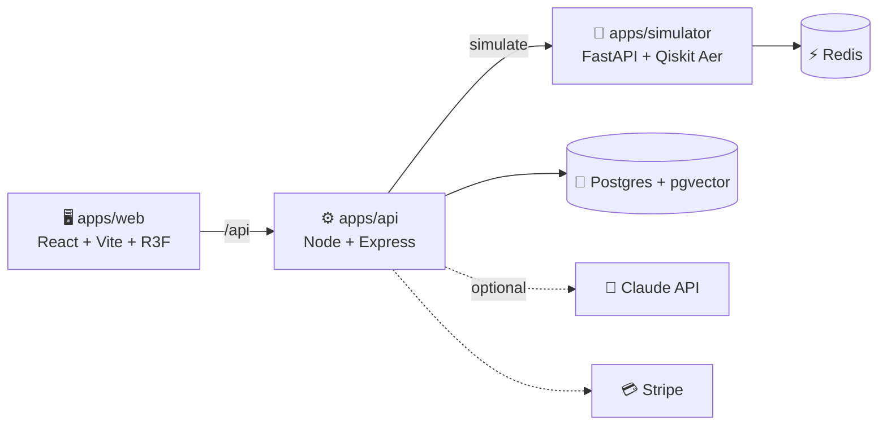

<div align="center">

# ⚛️ QVANTA

### Quantum Computing Education SaaS (MVP)

*Build circuits visually or in Qiskit code — always in sync. Simulate, visualize, and learn with an AI tutor that spots errors in your own circuit.*

<br />


**🏆 Team Code Busters · Smart India Hackathon (SIH) 2026**

[Features](#-features) · [Architecture](#-architecture) · [Quick Start](#-quick-start) · [Plans](#-tiered-plans) · [AI Tutor](#-ai-tutor--dual-path-mode) · [License](#-license)

</div>

---

## 📖 Overview

**QVANTA** is a production-grade, multi-tenant SaaS platform for interactive quantum computing education. Learners drag gates onto a 3D circuit, watch the Qiskit code update live (and vice versa), run the circuit on Qiskit Aer, and get coaching from a 3D virtual human tutor.

## ✨ Features

| | Feature | What it does |
|---|---|---|
| 🧊 | **3D Circuit Builder** | Drag-and-drop gates on qubit rails (React Three Fiber) with snap, keyboard navigation, and a 2D fallback |
| 💻 | **Monaco Qiskit Editor** | Bidirectional sync with the 3D scene, with parse-error markers |
| 🧪 | **Qiskit Aer Simulation** | Run up to 65,536 shots and view measurement histograms (Recharts) |
| 🌐 | **3D Bloch Spheres** | Per-qubit animated spheres with step-through, e.g. \|0⟩ → \|+⟩ after H |
| 🧑‍🏫 | **AI Virtual Tutor** | 3D avatar with TTS lip-sync, circuit-aware hints, optional Claude RAG |
| 💳 | **Stripe Billing** | Free / Pro tiers, webhook → tier, usage guard at the cap |
| 🔐 | **Auth** | Email + Google OAuth, JWT refresh, role-based guards |
| 📱 | **Responsive** | Mobile sidebar + Lite 2D SVG mode |

## 🏗️ Architecture



<details>
<summary><b>📂 Monorepo structure</b></summary>

```
.
├── apps/
│   ├── web/          # React + Vite + Tailwind frontend (3D builder, Monaco, tutor)
│   ├── api/          # Node.js Express platform API (auth, billing, circuits, tutor dispatch)
│   └── simulator/    # Python FastAPI quantum simulation microservice (Qiskit Aer + Redis)
├── packages/
│   ├── types/        # Shared TypeScript types (Circuit, GateOp, TutorMessage, etc.)
│   └── ui/           # Shared React component library + Tailwind preset
└── infra/
    ├── docker-compose.yml     # Postgres 16 + pgvector + Redis 7
    ├── api/Dockerfile         # API service image
    ├── simulator/Dockerfile   # Simulator microservice image
    ├── web/Dockerfile         # Web frontend image
    └── .github/workflows/ci.yml
```

</details>

## 🚀 Quick Start

> ⏱️ About 5–10 minutes. **Prerequisites:** Docker + Docker Compose, Node.js 20+, Python 3.11+, npm.

### 1. Start infrastructure *(Postgres + pgvector, Redis)*

```bash
docker compose -f infra/docker-compose.yml up -d
```

### 2. Install dependencies

```bash
npm install
```

### 3. Set up environment files

```bash
cp apps/api/.env.example apps/api/.env
cp apps/web/.env.example apps/web/.env
cp apps/simulator/.env.example apps/simulator/.env
```

> 💡 **Demo mode:** leave `GOOGLE_*`, `STRIPE_*`, and `ANTHROPIC_API_KEY` blank. Stripe buttons still appear and the tutor uses a keyword-driven fallback.

### 4. Install simulator dependencies *(optional for a quick smoke-test)*

```bash
cd apps/simulator
python -m venv .venv && source .venv/bin/activate  # Windows: .venv\Scripts\activate
pip install -r requirements.txt
```

### 5. Initialize the database

```bash
npm --workspace api run prisma:generate
npm --workspace api run prisma:migrate
```

### 6. Run the three services

| Terminal | Service | Command | URL |
|---|---|---|---|
| 1 | 🐍 Simulator | `uvicorn app.main:app --reload --host 0.0.0.0 --port 8000` *(from `apps/simulator`, venv active)* | `:8000` |
| 2 | ⚙️ API | `npm --workspace api run dev` | `http://localhost:3000` |
| 3 | 🖥️ Web | `npm --workspace web run dev` | `http://localhost:5173` |

> If the simulator isn't running, the API still boots and simulator requests return a clean 503 in the UI. The API seeds an admin from `ADMIN_EMAIL` / `ADMIN_PASSWORD_HASH` on first boot. Vite proxies `/api` → `localhost:3000`.

<details>
<summary><b>✅ Smoke-test the happy path</b></summary>

1. Register a local email/password user (no Google OAuth needed for dev).
2. Dashboard loads → modules list + usage meter (0/50 Free tier).
3. Open **Circuit Builder** → drag **H** onto q0·t0, **CNOT(q0→q1)** to t1 → add **Measure** on both at t2 → click **Simulate** (1024 shots). The Bell histogram should show ~50% `00` and ~50% `11`.
4. Open **AI Tutor** → ask *"What does H do?"* → reply includes "superposition" → TTS plays → mouth visemes animate → refresh and the history persists.
5. **Billing** shows the Free tier. Upgrade opens a Stripe checkout (mocked in test mode).

</details>

## 💎 Tiered Plans

| Tier | Sims / month | Max shots | Builder | Tutor | Instructor panels |
|:---|:---:|:---:|:---:|:---:|:---:|
| 🆓 **Free** | 50 | 1,024 | 3D + 2D | Demo mode | — |
| ⭐ **Pro** | Unlimited | 65,536 | 3D + 2D | Claude RAG | — |
| 🏫 **Institution** | Per seat | 65,536 | 3D + 2D | Claude RAG | Classroom dashboard |

## 🤖 AI Tutor — Dual-Path Mode

`tutor.service.ts` in `apps/api` auto-detects its mode at boot:

| Mode | Trigger | How it works |
|---|---|---|
| 🧠 **Claude mode** | `ANTHROPIC_API_KEY` is set | Calls `claude-3-haiku-20240307` with a prompt that injects **(1)** pgvector/keyword RAG snippets from `CourseModule.mdxContent`, **(2)** the current circuit JSON AST, **(3)** pre-flight warnings (missing Measure, self-target CNOT, out-of-range qubits). Up to 8 prior turns are threaded in. |
| 🛠️ **Demo mode** | No key | Enhanced keyword-coaching engine; RAG uses substring keyword scoring. Works fully offline, no secrets needed. |

## 🎯 MVP Acceptance Criteria

<details>
<summary><b>10 / 10 complete ✅ (click to expand)</b></summary>

| # | Criterion | Status |
|:-:|---|:-:|
| 1 | Monorepo `apps/{web,api,simulator}`, `packages/{ui,types}`, `infra/` present and buildable | ✅ |
| 2 | Register / login (email + Google OAuth routes), JWT refresh, role-based guards | ✅ |
| 3 | 3D drag-drop circuit builder (qubit rails, gate snap, keyboard nav, 2D fallback) | ✅ |
| 4 | Monaco Qiskit editor ↔ 3D scene bidirectional sync with parse-error markers | ✅ |
| 5 | Bell circuit simulation returns ~00 + ~11 counts; histogram via Recharts | ✅ |
| 6 | Tutor replies with "superposition" for H-gate Q; 3D avatar TTS lip-sync; persistence | ✅ |
| 7 | Stripe Free (50 sim cap) / Pro tiers; webhook → `user.tier`; usage-guard throws 402 at cap | ✅ |
| 8 | Per-qubit Bloch spheres; step-through shows \|0⟩ → \|+⟩ after H | ✅ |
| 9 | Mobile-responsive sidebar + Lite 2D SVG fallback toggle | ✅ |
| 10 | `npm -w @qvanta/types -w @qvanta/ui run build`, `npm -w api run typecheck`, `npm -w web run build` all exit 0 | ✅ |

</details>

## 👥 Team

<div align="center">

**Team Code Busters** · Smart India Hackathon 2026

</div>

## 📄 License

Released under the [MIT License](LICENSE). © 2026 Shivang.

<div align="center">

---

⚛️ *Made with curiosity, qubits, and a lot of chai.*

</div>
